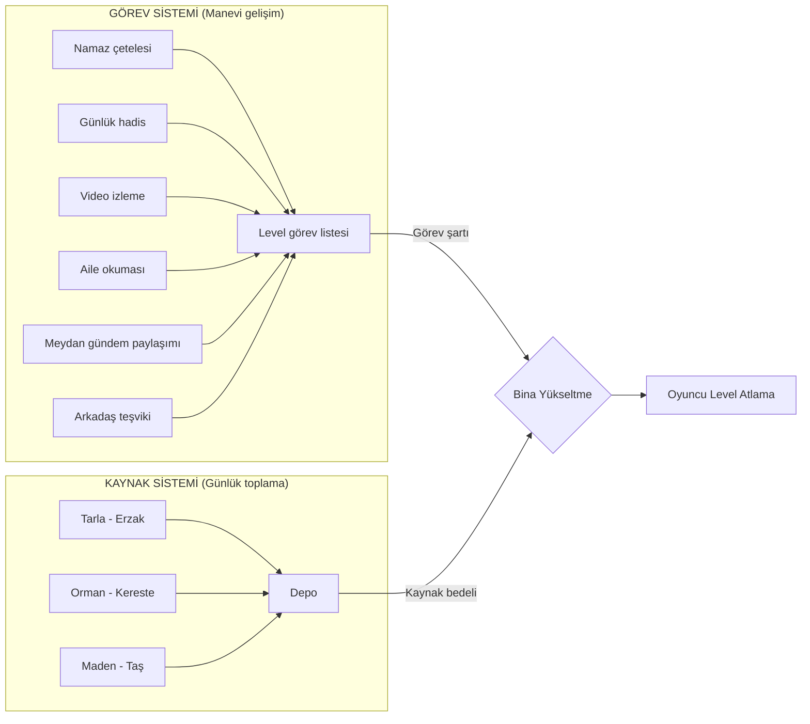

# Seyrüsefer v3 — Oyun Tasarım Dokümanı (Taslak 1)

> [!IMPORTANT]
> **Temel kural:** Görevler **kaynak vermez**. Kaynaklar sadece üretim alanlarından gelir ve **her gün girip toplanması** gerekir.
> Bir binayı yükseltmek için **iki anahtar** gerekir: 🔑 **Görev şartı** + 🔑 **Kaynak bedeli**. İkisinden biri eksikse inşaat başlamaz.

---

## 1. İki Ayrı Sistem

| | Görev Sistemi | Kaynak Sistemi |
|---|---|---|
| Ne sağlar? | Bina yükseltme **izni** ve level ilerlemesi | Bina yükseltme **bedeli** |
| Neye bağlı? | Öğrencinin gerçek hayattaki eylemlerine | Sadece zamana ve düzenli girişe |
| Etkileşim | Görev yapınca kaynak **artmaz** | Kaynak harcayınca görev **tamamlanmaz** |

---

## 2. Kaynak Ekonomisi

### Üretim Alanları (haritada sabit, inşa edilmez)
| Alan | Kaynak | Günlük üretim | Açılış |
|---|---|---|---|
| 🌾 Tarla (sol) | Erzak | 100 | Level 1 |
| 🌲 Orman (kenar ağaçlar) | Kereste | 80 | Level 1 |
| ⛏️ Maden (sağ) | Taş | 60 | Level 2 |

- Üretim saat saat birikir (örn. Erzak ≈ 4,2/saat).
- **Depo kapasitesi** dolunca üretim durur → öğrenci girip toplamazsa kaynak kaybeder.

### Depo kapasitesi (Otağ seviyesine bağlı)
| Otağ | Kapasite | Anlamı |
|---|---|---|
| Lv.1 | 24 saatlik üretim | Her gün girmek zorunlu |
| Lv.2 | 36 saatlik | Bir gün kaçırmaya küçük tolerans |
| Lv.3 | 48 saatlik | Hafta sonu toleransı |
| Lv.4 | 48 saat + Birlik deposu | — |

> [!NOTE]
> Görevler kaynak vermediği için “kaynak kasma” tamamen **düzenli giriş alışkanlığı** üzerine kurulu. Görev yapmayan ama her gün giren öğrenci kaynak biriktirir, fakat **görev şartı olmadan bina yükseltemez**. Görev yapan ama girmeyen öğrenci ise kaynak yetersizliğinden yükseltemez.

---

## 3. Level Atlama ve Bina Yükseltme Kuralı

**Bina yükseltme şartları:**
1. Oyuncu levelı yeterli olmalı (bina o levelda açılmış olmalı)
2. O binanın bu leveldaki **görev şartları** tamamlanmış olmalı
3. **Kaynak bedeli** ödenmeli

**Level atlama şartları:**
1. Levelın tüm **standart görevleri** tamamlanmış olmalı
2. Levelın **hedef binaları** inşa/yükseltilmiş olmalı

---

## 4. 10 Level Yol Haritası

Hedef süre: L1–3 ≈ 5’er gün, L4–6 ≈ 7’şer gün, L7–10 ≈ 10’ar gün → **toplam ≈ 11 hafta** (bir dönem).

| Lv | Gündem | Evre | Hedef binalar | Örnek görev şartları |
|---|---|---|---|---|
| 1 | Niyet ve İhlas | 🌱 Bireysel | Cami Lv.1 | 3 hadis, 1 video, 1 aile okuması |
| 2 | Namaz | 🌱 Bireysel | Medrese Lv.1 | 5 gün namaz çetelesi, 5 hadis, 1 video, 1 aile okuması |
| 3 | İlim ve Hikmet | 🌱 Bireysel | Sosyal Meydan Lv.1, Otağ Lv.2 | Hadis sınavı, ilk gündem paylaşımı, aile okuması |
| 4 | Dostluk ve Kardeşlik | 🤝 Birlik **açılır** | Cami Lv.2 | Birliğe katıl/kur, 3 arkadaşı teşvik et, gündem paylaşımı |
| 5 | Dürüstlük | 🤝 Birlik | Takas Merkezi, Medrese Lv.2, Meydan Lv.2 | 5 paylaşıma yorum, aile okuması, Seyyah görevleri |
| 6 | Yardımseverlik | 🤝 Birlik | Oyun Çadırı, Cami Lv.3, Otağ Lv.3 (**Alan mücadelesi açılır**) | Birlik ortak görevi, yarışmaya katılım |
| 7 | Aile ve Sıla-i Rahim | 🚩 Meydan | Medrese Lv.3, Meydan Lv.3 | Aile büyükleriyle okuma, 2 bölgeye hamle |
| 8 | Sabır ve Şükür | 🚩 Meydan | Cami Lv.4 | 7 gün kesintisiz namaz + hadis serisi |
| 9 | Adalet ve Emanet | 🚩 Meydan | Medrese Lv.4, Meydan Lv.4 | Alt level öğrencilere teşvik/rehberlik |
| 10 | İhsan | 🚩 Meydan | Otağ Lv.4 | Tüm gündemler + birlik hedefi → Mezuniyet sertifikası |

---

## 5. Kaynak Bedelleri (Taslak — Admin panelinden ayarlanabilir)

Bedeller, o levelın hedef süresindeki **üretimin ≈ %85’i** olacak şekilde hesaplandı (birkaç gün kaçırma payı). Level 4 sonrası üretimin bir kısmı birliğe bağışlanacağı için oran düşürüldü.

| Bina | Lv.1 | Lv.2 | Lv.3 | Lv.4 |
|---|---|---|---|---|
| 🕌 Cami | 400 E · 300 K | 550 E · 450 K · 300 T | 700 E · 550 K · 400 T | 1000 E · 800 K · 600 T |
| 📜 Medrese | 350 E · 300 K · 200 T | 250 E · 200 K · 150 T | 450 E · 350 K · 250 T | 500 E · 400 K · 300 T |
| 🌙 Sosyal Meydan | 200 E · 150 K · 100 T | 150 E · 100 K · 100 T | 400 E · 300 K · 250 T | 400 E · 350 K · 250 T |
| ⛺ Otağ | (hazır) | 250 E · 200 K · 150 T | 250 E · 200 K · 150 T | 1200 E · 1000 K · 800 T |
| 🏪 Takas Merkezi | 150 E · 150 K · 100 T | — | — | — |
| 🎪 Oyun Çadırı | 200 E · 150 K · 100 T | — | — | — |

*E = Erzak, K = Kereste, T = Taş*

---

## 6. Birlik ve Alan Mücadelesi (Level 4+)

- **Birlik Kasası:** Üyeler kendi kaynaklarından bağış yapar. Kasa; birlik seviyesi ve fetih hamleleri için harcanır.
- **Teşvik:** Görevini yapmamış birlik arkadaşına “Haydi Kardeşim!” bildirimi. (Kaynak vermez; teşviki yapılan görevi tamamlarsa iki öğrencinin de **birlik katkı puanı** artar.)
- **Alan Mücadelesi (Level 6+):** Bir bölgeye hamle için:
  - **Bedel:** Birlik kasasından kaynak
  - **Güç:** Birlik üyelerinin son 7 gündeki **görev tamamlama oranı** (namaz, hadis, video, okuma)
  - Böylece kaynak tek başına yetmez; birliğin manevi disiplini belirleyici olur.

---

## 7. Admin Paneli — Level Tasarım Merkezi

Her level (1–10) için tek ekrandan:
- Gündem başlığı ve açıklaması
- Hadis listesi (günlük sırayla)
- Video görevleri (ileri sarma engeli)
- Aile okuma metinleri
- Sosyal Meydan gündem sorusu
- Görev şartları ve hedef binalar
- Bina kaynak bedelleri
