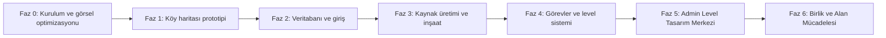

# Seyrüsefer v3 — Geliştirme Yol Haritası

## Mevcut Durum Tespiti

| Konu | Durum |
|---|---|
| `SEYRUSEFER V3\seyrusefer-v2` | Next.js 16 + React 19 + Tailwind 4 **boş iskelet** (sadece varsayılan sayfa). Temiz başlangıç için ideal. |
| Görseller | Hepsi `public` içinde, ama **her biri 4–7 MB PNG** (toplam ~150 MB). Mobilde kullanılamaz; WebP'ye çevrilip ~100–300 KB'a indirilmeli. |
| Canlı sistem (`seyrusefer-app`) | Cloudflare Workers + **D1** veritabanı + **R2** depolama, `seyrusefer.org` alan adı, OneSignal bildirimleri, cron'lar. Mevcut kullanıcılar ve hadis/soru verileri burada. |

> [!WARNING]
> Canlı sisteme dokunmayacağız. v3 ayrı bir projede gelişecek, hazır olunca alan adı v3'e çevrilecek.

## Önerilen Teknoloji

| Katman | Seçim | Neden |
|---|---|---|
| Arayüz | Next.js 16 (App Router) + Tailwind 4 | Zaten kurulu |
| Barındırma | Cloudflare (`@opennextjs/cloudflare`) | Mevcut alan adı, D1 ve R2 aynı yerde kalır |
| Veritabanı | Cloudflare D1 (yeni `seyrusefer-v3-db`) | Bildiğiniz altyapı; hadis/soru verileri taşınabilir |
| Medya | R2 (mevcut bucket) | Videolar ve büyük görseller |
| Bildirim | OneSignal (mevcut) | Teşvik bildirimleri için |

## Fazlar

| Faz | İçerik | Çıktı |
|---|---|---|
| **0** | Proje temizliği, görselleri WebP'ye çevirme, klasör yapısı, oyun sabitleri dosyası (level/bina/bedel tabloları) | Hafif ve düzenli proje |
| **1** | Arka plan haritası + boş arsalar + tıklanabilir bina noktaları + kaynak çubuğu + bina paneli (**sahte veriyle**) | Telefonda görülüp hissedilebilen köy |
| **2** | D1 şeması (kullanıcı, bina, kaynak, görev ilerlemesi), giriş/kayıt | Kalıcı kullanıcı verisi |
| **3** | Tarla/Orman/Maden üretimi, depo kapasitesi, toplama, inşaat/yükseltme | Günlük kaynak döngüsü |
| **4** | Görev panosu, namaz çetelesi, hadis, video (ileri sarma engeli), aile okuması, meydan paylaşımı, level atlama | Oyunun eğitsel çekirdeği |
| **5** | Admin: level gündemleri, içerik ve bedel düzenleme | İçeriği kod yazmadan yönetme |
| **6** | Birlik kurma/katılma (Lv.4+), kasa, teşvik, alan mücadelesi (Lv.6+) | Rekabet katmanı |

## İlk Adım: Faz 0 + Faz 1

Önce **görsel prototip** öneriyorum: haritada arsaların yeri, bina boyutları ve mobil görünüm, veritabanı kurmadan önce netleşmeli. Yanlış yerleşimi sonradan düzeltmek pahalı.
